# Protecting the ALU Logo on the Ethereum Blockchain

ALU's logo is an image file, so anyone can copy it, change it and pass it off as the real one. This project gives the logo a permanent, public record on the Ethereum blockchain. The record holds the logo's SHA-256 fingerprint, who registered it and when, so anyone can check for free whether a logo file is the original. A second contract splits ownership of the logo into 1,000,000 equal shares that ALU can give to staff, students and partners.

Both contracts are tested (8 of 8 tests pass), deployed and verified on the Sepolia public testnet.

---

## Contents

1. [Why a blockchain?](#1-why-a-blockchain)
2. [How the two contracts fit together](#2-how-the-two-contracts-fit-together)
3. [The ALU logo hash](#3-the-alu-logo-hash)
4. [Contract 1: ALUAssetRegistry (ERC-721)](#4-contract-1-aluassetregistry-erc-721)
5. [Contract 2: ALULogoToken (ERC-20)](#5-contract-2-alulogotoken-erc-20)
6. [Setup and usage](#6-setup-and-usage)
7. [The automated tests](#7-the-automated-tests)
8. [Live on Sepolia](#8-live-on-sepolia)
9. [Versions used](#9-versions-used)
10. [Project structure](#10-project-structure)
11. [Problems I ran into and how I solved them](#11-problems-i-ran-into-and-how-i-solved-them)
12. [Links](#12-links)

---

## 1. Why a blockchain?

The logo appears on certificates, transcripts, websites and merchandise. Anyone can download it, change a colour or a letter, and put it on a fake certificate. Today there is no quick, public way to check whether a logo file is the real one.

- **A database on an ALU server** can be edited or deleted by whoever runs it. Everyone else has to trust it, and if it goes offline nobody can check anything.
- **A trademark** protects the design in law, but it is slow and cannot tell anyone in seconds whether a particular file is the exact original.
- **A blockchain** is a public record copied across thousands of computers. Every entry is dated, anyone can read it for free, and nothing can be quietly changed afterwards. It doesn't replace the law. It adds proof that supports it.

Only the logo's **fingerprint** goes on the blockchain, not the image itself. That keeps it cheap while still showing up any change to the file.

## 2. How the two contracts fit together

| | `ALUAssetRegistry` | `ALULogoToken` |
|---|---|---|
| Standard | ERC-721 (NFT) | ERC-20 (fungible token) |
| Job | Proves **which** file is the real logo, **who** registered it and **when** | Records **how ownership** of the logo is shared |
| Each unit is | Unique, with its own ID and data | Identical to every other unit |
| Real-world comparison | A land title or a diploma | Company shares |

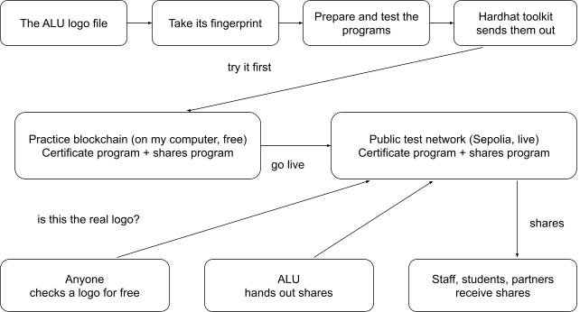

*How the system fits together: my computer, the two blockchains, and the people who use it.*

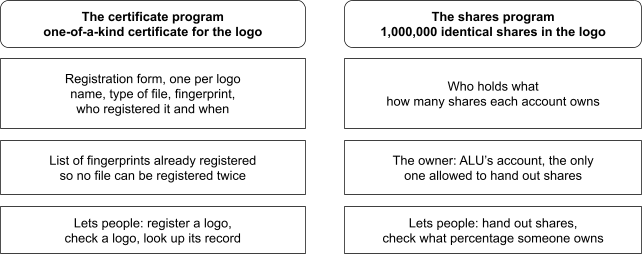

*What each contract stores, and what it lets people do.*

**Why two standards?** There is only one official logo, so it gets one unique certificate (ERC-721). Ownership shares must be identical, countable and divisible, so they use the standard for interchangeable tokens (ERC-20). 100,000 ALUT are worth the same whoever holds them.

## 3. The ALU logo hash

SHA-256 of [`alu-logo.png`](alu-logo.png) (1024 × 384 PNG, 25,271 bytes), the file that was registered:

```
838feb1f605244ddeaed00732d80e8603127202ab8c93db9b1e57fa1a7dfec76
```

As the `bytes32` value stored on-chain:

```
0x838feb1f605244ddeaed00732d80e8603127202ab8c93db9b1e57fa1a7dfec76
```

**Check it yourself** from the project folder. Both commands should print the same hash:

```bash
sha256sum alu-logo.png      # Linux (macOS: shasum -a 256 alu-logo.png)
npm run hash                # uses scripts/hash-logo.js
```

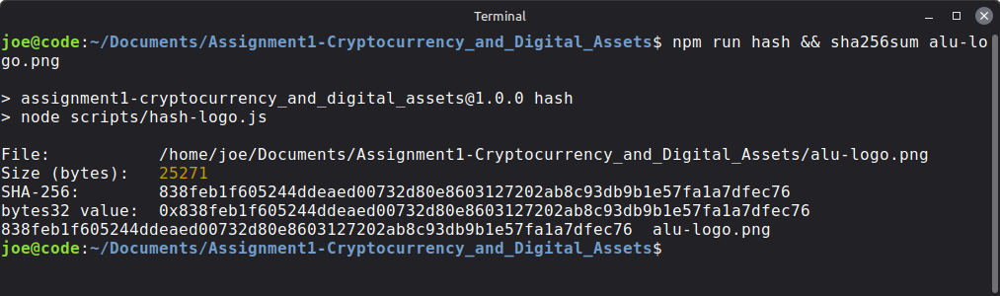

*The logo hash, calculated by `npm run hash` and confirmed by `sha256sum` on the last line.*

**Why one changed pixel changes everything:** SHA-256 is designed so that the smallest change to a file scrambles the result completely. I tested this by adding one invisible byte to the end of the logo file. The hash came out completely different, and the contract answered `Warning: logo does not match.`

## 4. Contract 1: ALUAssetRegistry (ERC-721)

File: [`contracts/ALUAssetRegistry.sol`](contracts/ALUAssetRegistry.sol). Extends OpenZeppelin's `ERC721`.

### What it stores

- **`AssetMetadata` struct**: the registration form for each asset.

  | Field | Type | Example |
  |---|---|---|
  | `assetName` | `string` | `"ALU Official Logo"` |
  | `fileType` | `string` | `"image/png"` |
  | `contentHash` | `bytes32` | `0x838f…ec76` |
  | `registeredBy` | `address` | the wallet that registered it |
  | `registeredAt` | `uint256` | Unix timestamp of the block |

- **`assets`**: `mapping(uint256 => AssetMetadata)`. Token ID → its record. Public, so anyone can read it.
- **`registeredHashes`**: `mapping(bytes32 => bool)`. Remembers every hash already registered, so the same file can never be registered twice.

### Functions

| Function | Type | What it does |
|---|---|---|
| `registerAsset(name, fileType, contentHash)` | write | Registers a file and mints its NFT to the caller. Returns the new token ID. |
| `verifyLogoIntegrity(tokenId, suppliedHash)` | view (free) | Compares a hash with the stored one. Returns `(true, "Logo is authentic.")` or `(false, "Warning: logo does not match.")`. |
| `getAsset(tokenId)` | view (free) | Returns the full `AssetMetadata` record. |
| `totalAssets()` | view (free) | Number of assets registered so far. |

**`registerAsset` step by step:**

1. Rejects an empty hash (`"Content hash cannot be empty."`).
2. Rejects a hash that is already registered (`"This file is already registered."`). If either check fails, the whole transaction is cancelled and nothing is saved.
3. Increments the counter to get the next token ID (the first is `1`).
4. Saves the metadata and marks the hash as used.
5. Mints the NFT to the caller with `_safeMint()`.
6. Emits `AssetRegistered(tokenId, registeredBy, contentHash)` and returns the token ID.

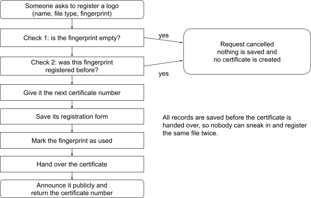

*The registration process: two checks that can cancel the request, then the steps that create the NFT.*

The records are saved **before** `_safeMint()` (checks → effects → interactions). `_safeMint()` can call into the receiving contract, so this order stops a malicious receiver from re-entering and registering the same hash twice.

`verifyLogoIntegrity` and `getAsset` only read data, so calling them costs no gas and doesn't even need a wallet. Both revert if the token ID doesn't exist.

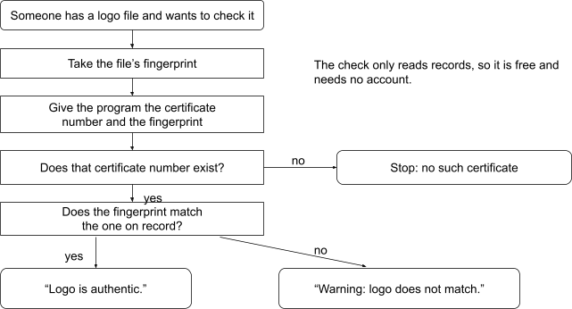

*How a logo check works.*

<details>
<summary>Show the code screenshots</summary>

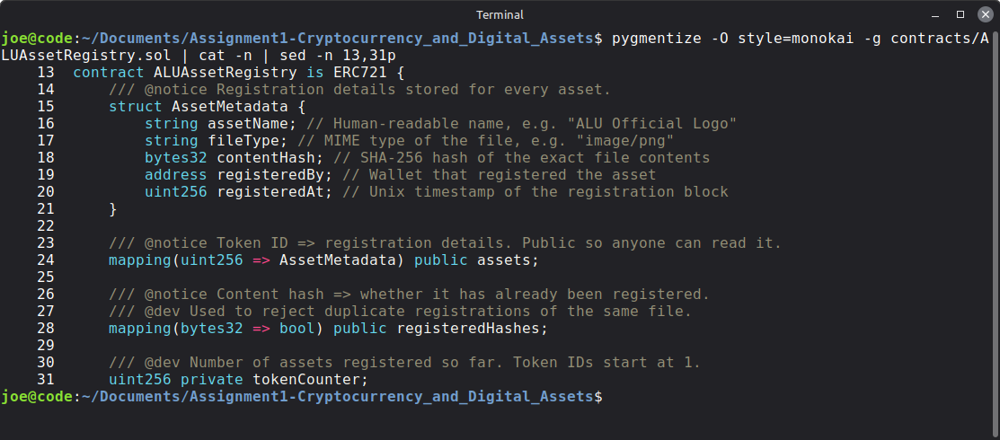

*The `AssetMetadata` struct and the two mappings.*

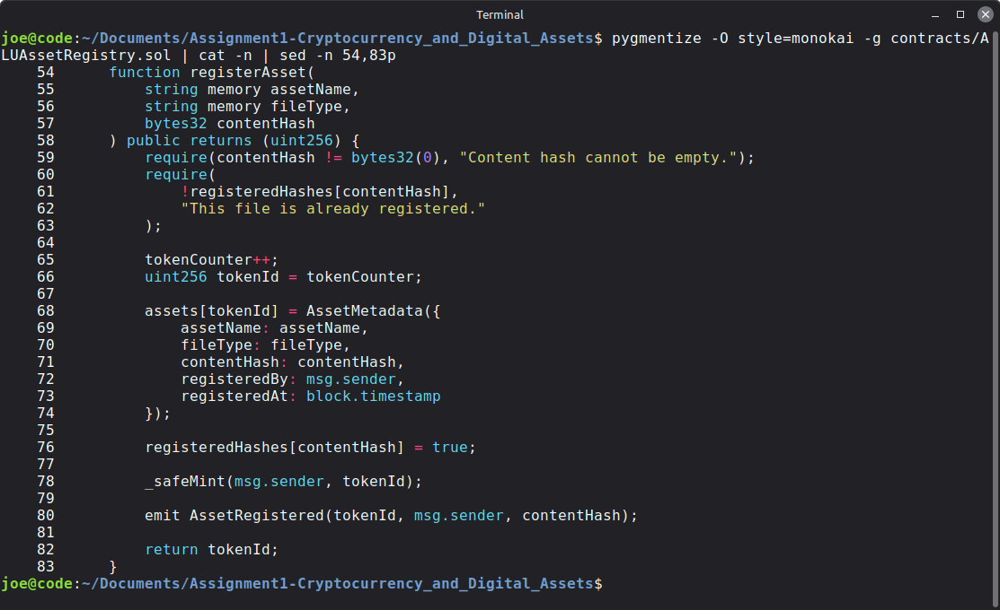

*`registerAsset()`: the two checks come first, and the records are saved before the NFT is minted.*

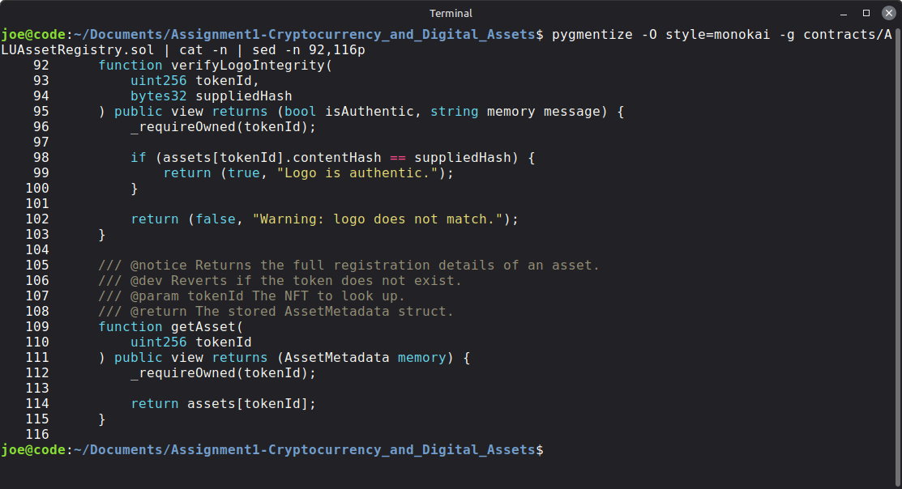

*`verifyLogoIntegrity()` and `getAsset()`.*

</details>

## 5. Contract 2: ALULogoToken (ERC-20)

File: [`contracts/ALULogoToken.sol`](contracts/ALULogoToken.sol). Extends OpenZeppelin's `ERC20` and `Ownable`.

### Token setup

- Name **ALU Logo Token**, symbol **ALUT**.
- The constructor takes a `logoOwner` address. It mints all **1,000,000 ALUT** to that address and makes it the contract owner. There is no mint function, so the supply can never grow.
- `decimals()` returns `0`, so 1 ALUT is exactly one share, never a fraction.

### Functions

| Function | Type | What it does |
|---|---|---|
| `distributeShares(recipient, amount)` | write, `onlyOwner` | Moves `amount` ALUT from the owner to `recipient`. Rejects a zero amount, any caller other than the owner, and amounts larger than the owner's balance. Emits `SharesDistributed`. |
| `ownershipPercentage(account)` | view (free) | Returns `balance × 100 / totalSupply` as a whole number. 500,000 ALUT → `50`. Holdings below 1% return `0`. |

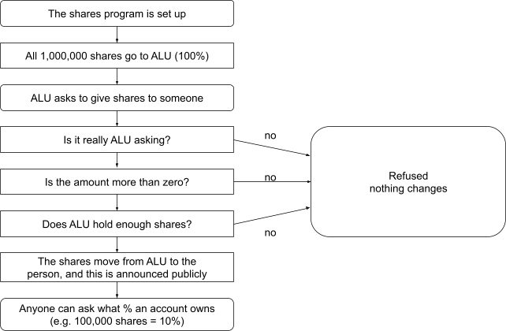

*How shares are created, handed out and measured.*

<details>
<summary>Show the code screenshots</summary>

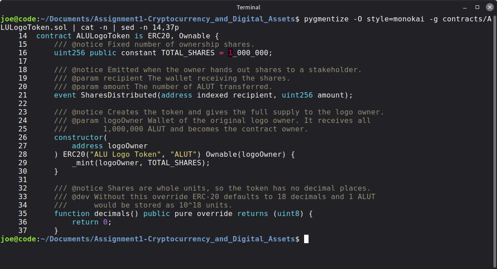

*The constructor creates all 1,000,000 ALUT and gives them to the logo owner.*

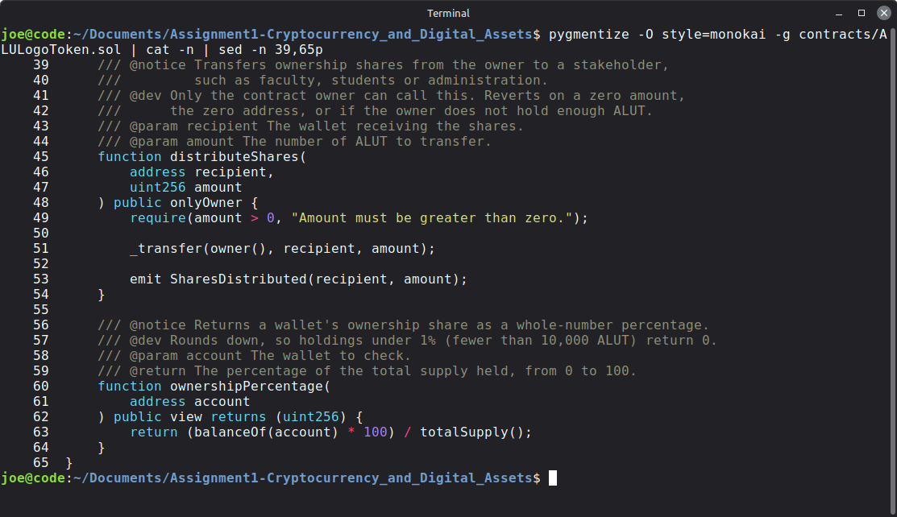

*`distributeShares()` and `ownershipPercentage()`.*

</details>

### What tokenisation means for ALU

Tokenisation turns ownership of something into digital tokens. ALU starts with all 1,000,000 ALUT (100%) and can hand shares to the people who build the brand:

- **Administration and board**: keep the majority, so ALU stays in control.
- **Faculty**: their teaching and research give the logo its value.
- **Students and alumni**: they carry the logo into the world.
- **Partners**, such as an official merchandise maker: a share could reflect a licensing deal.

**Example:** a faculty member holding 100,000 ALUT owns 10% of the logo's shares, and anyone can confirm it on-chain. If ALU earned licensing income from the logo, that could mean 10% of it, and if decisions about the logo were put to a vote, 10% of the votes. Those rights only exist if ALU also writes them into a real agreement. The blockchain records ownership; the law gives it force.

## 6. Setup and usage

Everything is built and tested on a local blockchain first, then put live on the Sepolia testnet.

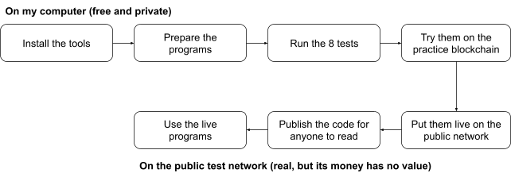

*The path from my computer to the live network.*

### Requirements

- [Node.js](https://nodejs.org/) 18 or newer, and npm
- Git

### Step 1: Get the code and install dependencies

```bash
git clone https://github.com/josep-prog/Assignment1-Cryptocurrency_and_Digital_Assets.git
cd Assignment1-Cryptocurrency_and_Digital_Assets
npm install
```

This installs Hardhat, ethers.js, the OpenZeppelin contracts and the test tools listed in `package.json`.

### Step 2: Compile the contracts

```bash
npm run compile
```

Hardhat translates the Solidity code into bytecode the Ethereum network can run. It compiles the 2 contracts plus the OpenZeppelin files they import (17 files in total) and writes the output to `artifacts/`.

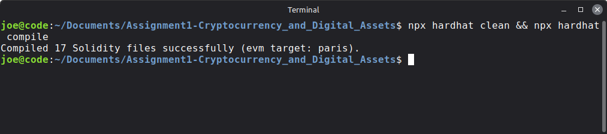

### Step 3: Run the tests

```bash
npm test
```

The tests run on Hardhat's built-in blockchain, which starts and stops automatically, so no setup is needed. All 8 should pass:

```
  ALU Logo Project
    Logo registration
      ✔ 1. Registers the logo and returns a token ID
      ✔ 2. Rejects a duplicate file hash
      ✔ 3. Accepts the correct logo hash
      ✔ 4. Rejects an incorrect logo hash
      ✔ 5. Returns the correct asset metadata
    Ownership shares
      ✔ 6. Mints all 1,000,000 tokens to the logo owner
      ✔ 7. Lets only the owner distribute a positive amount
      ✔ 8. Calculates ownership percentages correctly

  8 passing
```

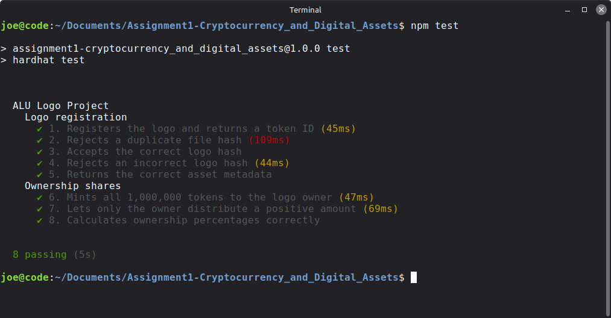

### Step 4: Run a local blockchain and deploy to it

A local blockchain behaves like the real Ethereum network, with accounts, balances and transactions, but it runs only on your computer. It is free, instant and can be wiped at any time, so mistakes cost nothing.

Open **two terminals** in the project folder.

**Terminal 1**, start the local node:

```bash
npm run node
```

It starts a blockchain at `http://127.0.0.1:8545` and prints 20 test wallets, each holding 10,000 fake ETH. Leave it running.

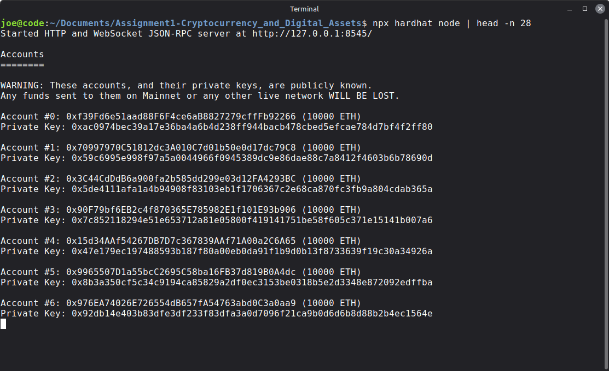

> The private keys of these test wallets are published openly. Never use them on a real network.

**Terminal 2**, deploy:

```bash
npm run deploy:local
```

[`scripts/deploy.js`](scripts/deploy.js) does the whole job in one go:

1. Reads `alu-logo.png` and calculates its SHA-256 hash.
2. Deploys `ALUAssetRegistry`.
3. Calls `registerAsset("ALU Official Logo", "image/png", <hash>)` and reads the token ID from the `AssetRegistered` event.
4. Double-checks the record with `getAsset()` and `verifyLogoIntegrity()`.
5. Deploys `ALULogoToken`, passing the deployer's address so all 1,000,000 ALUT go to them.
6. Prints the results and saves the addresses to `deployments/localhost.json`.

You should see the logo registered as token ID `1`, `Integrity check: true - Logo is authentic.`, a total supply of `1000000` and `Owner percentage: 100%`.

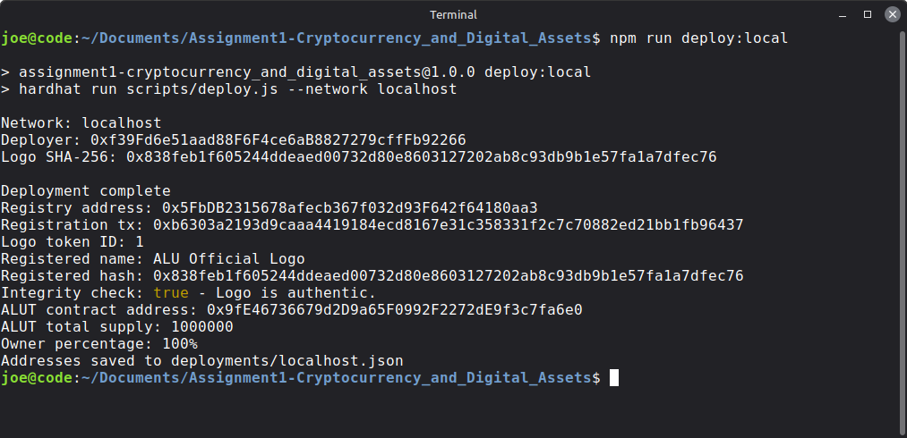

### Step 5: Deploy to the Sepolia testnet (optional)

Sepolia is Ethereum's public test network. It works like the real network, with public explorers such as Etherscan, but its ETH is free and has no value.

1. Create a file named `.env` in the project folder with these three lines:

   ```bash
   SEPOLIA_RPC_URL=
   PRIVATE_KEY=
   ETHERSCAN_API_KEY=
   ```

2. Fill in the values:

   | Variable | What to put |
   |---|---|
   | `SEPOLIA_RPC_URL` | A Sepolia RPC endpoint, from Alchemy or Infura, or the public `https://ethereum-sepolia-rpc.publicnode.com` |
   | `PRIVATE_KEY` | The private key of a **test-only** wallet. Never use a wallet that holds real funds. |
   | `ETHERSCAN_API_KEY` | Optional. Only needed to verify the contracts on Etherscan. |

3. Get free Sepolia ETH from a faucet, such as the Google Cloud Web3 faucet. About 0.01 ETH is enough.

4. Deploy, verify and try the live contracts:

   ```bash
   npm run deploy:sepolia
   npx hardhat verify --network sepolia <ALUAssetRegistry address>
   npx hardhat verify --network sepolia <ALULogoToken address> <deployer address>
   npm run interact:sepolia
   ```

`interact:sepolia` runs [`scripts/interact.js`](scripts/interact.js) against the deployed contracts. It reads the logo record, checks the real logo (authentic) and a tampered copy (rejected), sends 100,000 ALUT to an example stakeholder (only the first time it runs), and prints both ownership percentages.

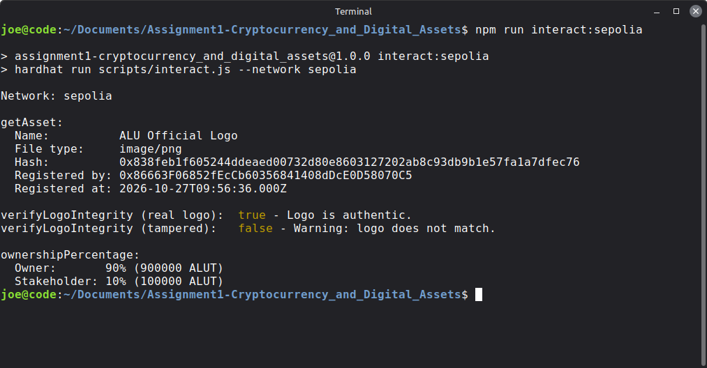

`.env` is listed in `.gitignore` and is never committed. `hardhat.config.js` only adds the Sepolia network when `.env` is filled in, so local work needs no secrets.

### All commands at a glance

| Command | What it does |
|---|---|
| `npm install` | Install dependencies |
| `npm run compile` | Compile the contracts |
| `npm test` | Run the 8 automated tests |
| `npm run hash` | Print the SHA-256 hash of `alu-logo.png` |
| `npm run node` | Start a local blockchain |
| `npm run deploy:local` | Deploy both contracts to the local blockchain |
| `npm run deploy:sepolia` | Deploy both contracts to Sepolia |
| `npm run interact:sepolia` | Call every function on the Sepolia deployment |

## 7. The automated tests

File: [`test/ALUAssetRegistry.test.js`](test/ALUAssetRegistry.test.js). Each test starts with freshly deployed contracts, so tests can't affect each other, and all of them use the hash of the real `alu-logo.png`.

| # | What the test checks | Why it matters |
|---|---|---|
| 1 | The logo registers, returns token ID `1`, emits `AssetRegistered` and the NFT belongs to the caller | Registration works |
| 2 | Registering the same hash again reverts with `"This file is already registered."` | Nobody can register the logo twice or claim it after ALU |
| 3 | `verifyLogoIntegrity()` with the correct hash returns `true` and `"Logo is authentic."` | Real files are recognised |
| 4 | `verifyLogoIntegrity()` with a hash one bit different returns `false` and `"Warning: logo does not match."` | Even the smallest change is detected |
| 5 | `getAsset()` returns the correct name, file type, hash, registrant and timestamp | Records can be looked up correctly |
| 6 | All 1,000,000 ALUT are minted to the logo owner, with the right name, symbol and owner | Ownership starts at 100% with ALU |
| 7 | `distributeShares()` moves 100,000 ALUT to a recipient, and rejects non-owners and a zero amount | Only ALU can hand out shares |
| 8 | A wallet holding 500,000 ALUT is reported as owning `50`% | Percentages are calculated correctly |

## 8. Live on Sepolia

Both contracts are deployed and their source code is verified on Etherscan, so anyone can read it and confirm it matches what is running.

| Item | Address / value |
|---|---|
| ALUAssetRegistry (NFT) | [`0xA471fB76f0c2432Faf36d5f699C8868FAF0ab3B9`](https://sepolia.etherscan.io/address/0xA471fB76f0c2432Faf36d5f699C8868FAF0ab3B9#code) |
| ALULogoToken (ALUT) | [`0x9C0B96aA3A3b564a03fad5b53d23775d066d44C3`](https://sepolia.etherscan.io/address/0x9C0B96aA3A3b564a03fad5b53d23775d066d44C3#code) |
| Deployer and logo owner | [`0x86663F06852fEcCb60356841408dDcE0D58070C5`](https://sepolia.etherscan.io/address/0x86663F06852fEcCb60356841408dDcE0D58070C5) |
| Logo registration transaction | [`0x2825a66b…5c28cc`](https://sepolia.etherscan.io/tx/0x2825a66b342c5d94d493e6b2b1570307ee08d38129651d039fd57155075c28cc) |
| Share distribution transaction | [`0x07f305a7…30665e`](https://sepolia.etherscan.io/tx/0x07f305a74cd818312cc0badfdb235e0507bad889fd5076707a43ef4f1f30665e) |
| Logo token ID | `1` |
| Registered at | 27 October 2026, 09:56:36 UTC |

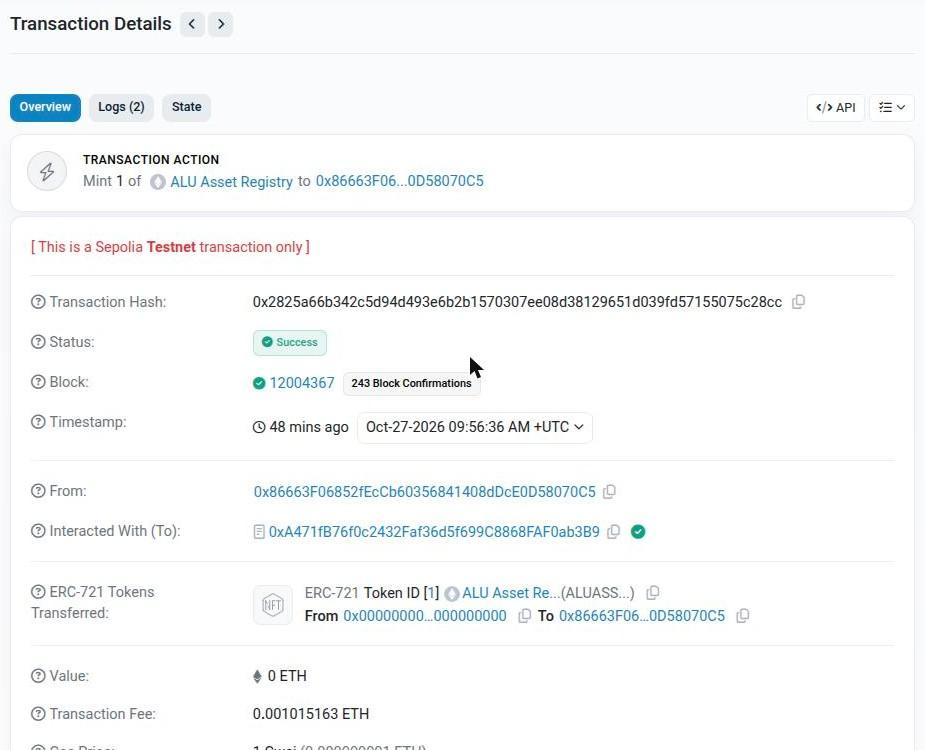

*The logo's registration on Sepolia: status Success, token ID 1 minted to ALU's account.*

After the share distribution, ALU holds 900,000 ALUT (90%) and the stakeholder holds 100,000 ALUT (10%).

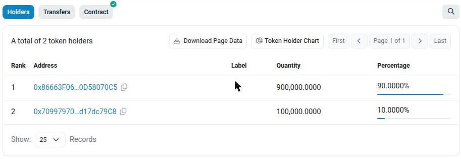

*ALUT holders on Etherscan: 900,000 (90%) and 100,000 (10%).*

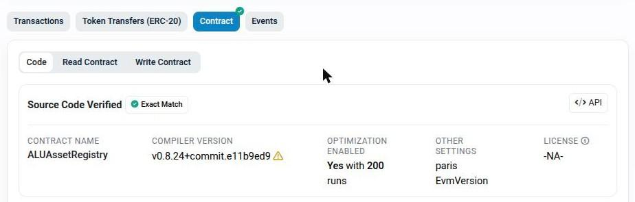

*Etherscan confirms the published source code matches what is running.*

**Check the logo without installing anything:**

1. Open the [registry on Etherscan](https://sepolia.etherscan.io/address/0xA471fB76f0c2432Faf36d5f699C8868FAF0ab3B9#readContract) and go to the **Read Contract** tab.
2. Open `verifyLogoIntegrity`, enter token ID `1` and the `bytes32` hash from [section 3](#3-the-alu-logo-hash).
3. Click **Query**. It answers `true, Logo is authentic.`

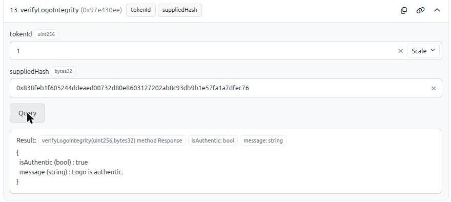

## 9. Versions used

| Tool | Version |
|---|---|
| Solidity | 0.8.24 (optimizer on, 200 runs) |
| Hardhat | 2.29.1 |
| OpenZeppelin Contracts | 5.0.2 |
| ethers.js | 6.17.0 |
| Node.js | v22.23.3 |
| npm | 10.9.9 |

## 10. Project structure

```
contracts/
  ALUAssetRegistry.sol      ERC-721 registry: registerAsset, verifyLogoIntegrity, getAsset
  ALULogoToken.sol          ERC-20 shares: distributeShares, ownershipPercentage
scripts/
  deploy.js                 deploys both contracts and registers the real logo hash
  hash-logo.js              prints the SHA-256 hash of alu-logo.png
  interact.js               calls every function on an already-deployed network
test/
  ALUAssetRegistry.test.js  the 8 automated tests
deployments/
  sepolia.json              addresses saved by deploy.js
alu-logo.png                the ALU logo file that was hashed and registered
hardhat.config.js           compiler, networks and Etherscan settings
package.json                dependencies and npm scripts
images/
  diagrams/                 the diagrams used in this README and the report
  screenshots/              terminal, code and Etherscan screenshots
Project_Report.pdf   the written report
```

## 11. Problems I ran into and how I solved them

1. **The tests could not find the logo file.**
   The official logo I had was an SVG, but the brief, tests and deploy script all expect `alu-logo.png`, so every test failed with `ENOENT: no such file or directory`. I converted the SVG into a real 1024 × 384 PNG. Simply renaming the SVG would have made the registered file type `image/png` false.

2. **The deploy script assumed the token ID.**
   `deploy.js` hard-coded the new token ID as `1`, which would be wrong on a registry that already had assets. It now reads the ID from the `AssetRegistered` event in the transaction receipt.

3. **Token amounts were not whole shares.**
   ERC-20 uses 18 decimals by default, so minting `1,000,000` would have created a tiny fraction of one token. I overrode `decimals()` to return `0`, so 1 ALUT is exactly one share.

4. **The default `npm test` script failed.**
   `npm init` creates a placeholder test script that just prints an error. I replaced it with `hardhat test` and added shortcut scripts for compiling, hashing, deploying and interacting.

5. **I needed a safe wallet for the testnet.**
   The wallets printed by `hardhat node` have publicly known private keys. I created a fresh test-only wallet for Sepolia and kept its key in `.env`, which Git ignores.

6. **The interaction script was not safe to re-run.**
   Running `interact.js` twice would have sent the stakeholder shares twice. It now checks the stakeholder's balance first and only calls `distributeShares()` if they hold nothing yet.

7. **Etherscan sometimes timed out.**
   One `hardhat verify` run failed with `Connect Timeout Error`, which came from Etherscan, not the code. Retrying worked, and both contracts are verified.

8. **The order of steps inside `registerAsset()` mattered for safety.**
   `_safeMint()` can call into the receiving contract. The contract therefore saves the metadata and marks the hash as used before minting (checks → effects → interactions), so a malicious receiver can't re-enter and register the same hash twice.

### What I would improve with more time

- **Limit who can register.** Today any account can register any file. In real use, only ALU-approved accounts should be able to, ideally with approval from several ALU officials.
- **Store the logo image itself** on IPFS and link it to the NFT, so the original can be downloaded, not only checked.
- **Link the token to the NFT**, so `ALULogoToken` records exactly which registered logo it represents.
- **Show more precise percentages**, since holdings below 1% currently show as `0`.
- **Build a web interface** where anyone can drop in a logo file and see "authentic" or "fake" instantly. This is the next assignment.

## 12. Links

| Item | Link |
|---|---|
| GitHub repository | https://github.com/josep-prog/Assignment1-Cryptocurrency_and_Digital_Assets |
| Written report | [`Project_Report.pdf`](Project_Report.pdf) |
| Demo video | https://youtu.be/NZUc-ZKCCdw |
| ALUAssetRegistry on Etherscan | https://sepolia.etherscan.io/address/0xA471fB76f0c2432Faf36d5f699C8868FAF0ab3B9 |
| ALULogoToken on Etherscan | https://sepolia.etherscan.io/address/0x9C0B96aA3A3b564a03fad5b53d23775d066d44C3 |
